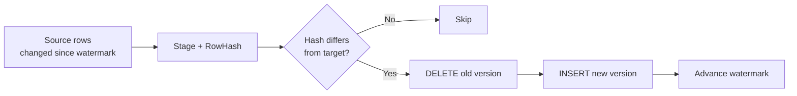

# 01 · Incremental ETL framework for Fabric Warehouse

**Area:** Microsoft Fabric Warehouse · T-SQL · Change Tracking

## Context
Fact tables such as posted sales and repairs load into a Fabric Warehouse from on-premises SQL Server sources that use Change Tracking. Each table had its own load logic, so behaviour varied from one table to the next and reruns were risky.

## Challenge
- Loads had to be **safely re-runnable** after a failure
- Only **changed rows** should move on each run
- Fabric Warehouse `MERGE` was **not mature enough** for production use
- The same procedure needed to cover first loads, schema changes and daily increments

## Approach
I standardised every load procedure on one pattern:

| Element | Design |
|---|---|
| Load modes | `FULL` (truncate + reload), `RECREATE` (drop + rebuild), `UPSERT` (incremental) |
| Change detection | SHA2-256 `RowHash` over business columns, comparing a single hash instead of every column |
| Incremental window | `SYS_CHANGE_DATETIME` watermark, advanced only on success |
| Apply step | `DELETE` changed keys + `INSERT`, replacing `MERGE` |
| Safety | Explicit transaction, `TRY/CATCH`, run log |

## Outcome
- One consistent, documented pattern used across fact table procedures
- Failed runs can be re-run without duplicating data
- No dependency on `MERGE` in Fabric Warehouse

**Template:** [fabric-warehouse-etl-patterns](../fabric-warehouse-etl-patterns)
