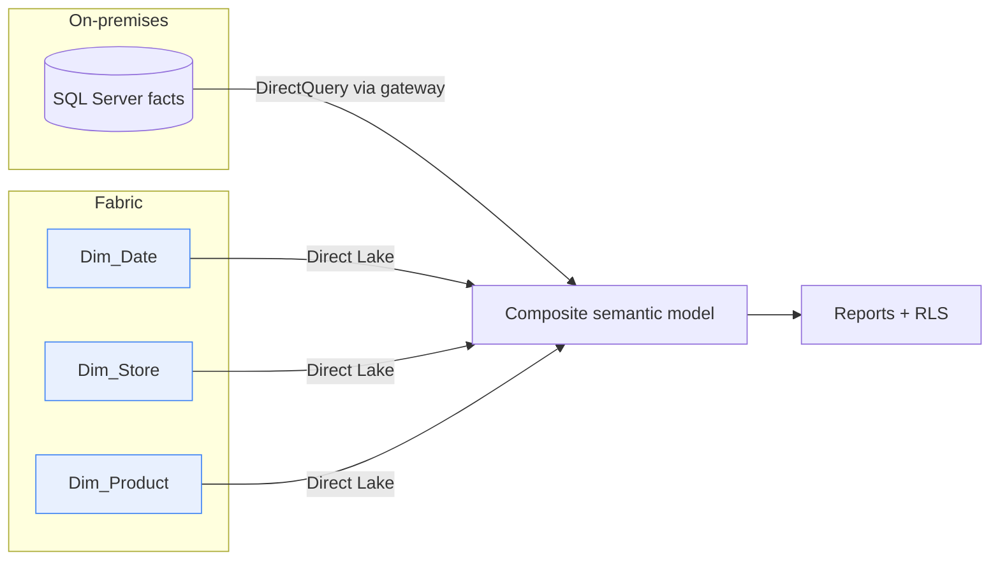

# 02 · Composite semantic model: Direct Lake + on-prem DirectQuery

**Area:** Power BI · DAX · Row-level security · On-premises data gateway

## Context
Dimensions were in a Fabric Lakehouse/Warehouse, but some fact data still lived in on-premises SQL Server. Reports had to combine both in one model.

## Challenge
- Mix **Direct Lake** dimensions with **DirectQuery** facts through an on-premises gateway
- Keep DAX correct across tables at different grains
- Apply **row-level security** consistently across both storage modes
- Resolve **publishing and gateway binding errors** in the Power BI service

## Approach

- Designed relationships and storage modes by query pattern
- Used `TREATAS` for virtual relationships where grains differed, `USERELATIONSHIP` for role-playing dates, and `CROSSFILTER` for per-measure filter direction
- Implemented dynamic RLS from a user-to-store mapping table
- Built measure-driven conditional formatting for matrix visuals
- Diagnosed and fixed gateway data source binding after publishing

## Outcome
- One model serving both cloud and on-premises data
- Security enforced the same way across storage modes
- A repeatable fix for publishing and gateway binding issues

**Patterns:** [powerbi-dax-patterns](../powerbi-dax-patterns)
