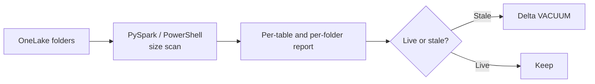

# 04 · Diagnosing Fabric Warehouse storage bloat

**Area:** Microsoft Fabric · OneLake · PySpark · PowerShell · Delta Lake

## Context
Storage reported for a Fabric Warehouse was much larger than the data it held. Storage costs and capacity usage were growing with no clear reason.

## Challenge
- The Fabric UI did not show where the storage was going
- Storage had to be measured at file level in OneLake
- Cleanup had to be safe for live tables

## Approach
1. **Built storage analysis tooling** in PowerShell and PySpark to list OneLake folders and sum file sizes per table and per folder
2. **Found the cause:** unexpected storage in the warehouse's `Files` subdirectories, separate from the active table data
3. **Separated** live Delta files from old file versions and orphaned files
4. **Cleaned up safely** with Delta `VACUUM`, respecting retention so time travel and running queries were not affected
5. **Documented** the method so it can be re-run as a routine check

## Outcome
- Root cause of the excess storage identified
- A reusable tool for storage audits
- A safe, documented cleanup procedure
