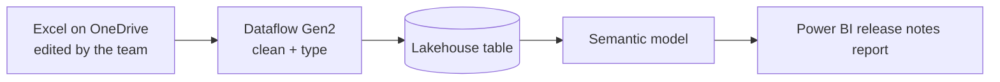

# 05 · Release notes app on Fabric

**Area:** Dataflow Gen2 · Fabric Lakehouse · Power BI

## Context
Business users needed one place to see what had changed in reports and data: new reports, fixes and changes to measures.

## Challenge
- Release notes had to be **easy to maintain** for non-technical editors
- They needed to be **searchable and filterable** inside Power BI
- Build it with low cost, using the existing platform

## Approach
Editors maintain an Excel list in OneDrive. Fabric handles the rest:

- Dataflow Gen2 validates and shapes the list on a schedule
- The Lakehouse stores the history
- The report filters by date, area, report name and change type

## Outcome
- Users can see changes in the same tool they use every day
- Editors only update a spreadsheet, and nothing else changes for them
- Built entirely on the existing Fabric capacity
