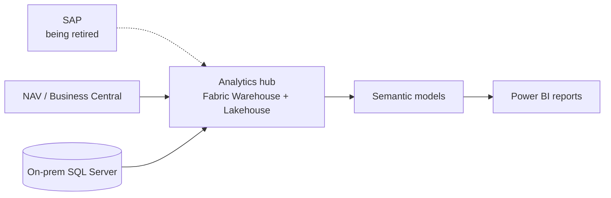

# 07 · Moving reporting off SAP to an analytics hub

**Area:** Platform migration · Data warehousing · Dynamics NAV / Business Central · SQL Server · Fabric

## Context
The business was decommissioning SAP and moving its reporting to an internal analytics hub, with data sources including Dynamics NAV / Business Central and on-premises SQL Server.

## Challenge
- Keep reports running while their source systems changed
- Map data from several ERPs to one warehouse model
- Agree scope with many stakeholders and keep it under control

## Approach
- **Designed loads** from NAV/BC and SQL Server into the warehouse using Change Tracking and the standard [ETL framework](01-fabric-etl-framework.md)
- **Evaluated Fabric Mirroring** as a complement to Change Tracking pipelines, and assessed hybrid architectures
- **Explored Azure Logic Apps** as middleware / API gateway between on-premises SQL Server, NAV 2017 and cloud services
- **Managed scope and stakeholder communication:** documented decisions, process and change control

## Outcome
- A single analytics layer that doesn't depend on the system being retired
- Ingestion options assessed and documented (Change Tracking, Mirroring, middleware)
- Clear scope and communication throughout the migration
