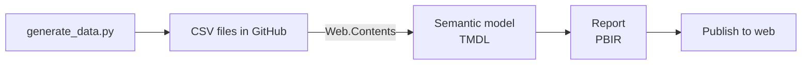

# 08 · Retail sales report in Power BI (public demo)

**Area:** Power BI · TMDL · PBIR · DAX · Data modelling

## Context
A public, interactive example of how I build Power BI reports, using generated retail data so it can be shared openly.

## Challenge
- Answer the questions a retail leadership team asks every week: are we on target, are we growing, where are we behind, and why
- Hold targets at a different grain (store × month) from sales (line level)
- Keep the model clean enough to hand over: explicit measures, documented and version-controlled

## Approach
- **Star schema** with Date, Store, Product and Channel dimensions and single-direction relationships
- **Targets without a bridge table:** the `Target` measure applies the store and month filters with `TREATAS`
- **Two pages, each with one job:** a sales overview (target, growth, regions) and products and pricing (mix, discount, margin)
- **Built as a Power BI Project:** model in TMDL and report in PBIR, so every measure and visual is reviewable in Git
- **Data loads over HTTPS** from this repository, so the published report refreshes without a gateway

## Outcome
- An interactive report anyone can open without a Power BI licence
- Source that shows how the report is built, not only what it looks like

**Project:** [powerbi-retail-showcase](../powerbi-retail-showcase)
