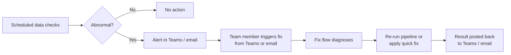

# 09 · Automated data monitoring and remote fixes with Power Automate

**Area:** Power Automate · Microsoft Teams · Data pipelines · Data quality

## Context
Reports are only useful if the data behind them is complete and correct. Problems such as missing loads, unusual figures or a failed pipeline were usually found by users after the report was already wrong.

## Challenge
- Detect data problems **before** the business sees them
- Tell the right people straight away, wherever they are
- Fix common issues quickly, without needing someone at a desk to log in to the platform

## Approach
I built two sets of Power Automate flows.

**1. Monitoring flows**
- Run checks against the data on a schedule, for example missing or late loads, unexpected row counts, and values outside their normal range
- When something looks wrong, post an alert to Microsoft Teams and send an email that says what was found and where

**2. Fix flows, triggered remotely**
- From the alert, a team member can start a fix directly from **Teams or email**
- The fix flow **diagnoses** the issue, then runs the right fix: re-running the pipeline or applying a known quick fix
- The result is reported back to the same channel, so everyone sees the issue is resolved

## Outcome
- Data issues are caught and reported before users find them
- Common problems are fixed in minutes from a phone, without logging in to the platform
- Every alert and fix leaves a record in Teams

## Skills shown
Power Automate · Microsoft Teams integration · pipeline orchestration · data quality checks · operational support
