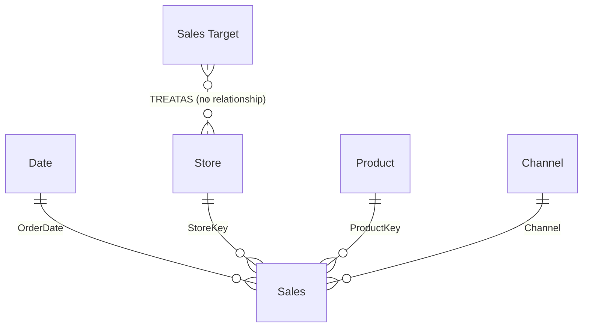

# Retail Sales Report (Power BI)

An interactive retail sales report built as a Power BI Project (PBIP): semantic model in TMDL, report in PBIR. All data is generated sample data.

**Live report:** _link added after publishing_

## What the report answers

**Sales overview**
- Are we ahead of target and last year? (KPI cards)
- How did each month compare with last year and target? (line chart)
- Which categories drive sales? (bar chart)
- Which regions and stores are under target? (matrix with drill-down, variance chart)

**Products and pricing**
- Which subcategories sell most? (bar chart, filters the page)
- How do discount and margin compare across subcategories? (scatter, bubble size = net sales)
- How do margin and discount move through the year? (line chart)
- Which brands are growing? (matrix)

Year, Region and Channel slicers are synced across both pages.

## Model



| Table | Rows | Notes |
|---|---|---|
| Sales | ~124,000 | One row per sales line, 2024–2025 |
| Date | 731 | Marked as date table; auto date/time is off |
| Store | 22 | Region, city and store format |
| Product | 120 | Category, subcategory and brand |
| Channel | 2 | In-store, Online |
| Sales Target | 528 | Monthly target per store, at a different grain from Sales |

**Design choices**
- Star schema, single-direction relationships, all keys hidden
- **Targets** are stored at store × month grain with no relationship. The `Target` measure applies the store and month filters with `TREATAS`, so the model doesn't need a bridge table.
- **Explicit measures only.** Implicit measures are disabled, and every measure has a format string, display folder and description.
- `DIVIDE()` for every ratio, and time intelligence goes through the date table
- Slicers come from dimension tables, not the fact table

## Key measures

```dax
Target =
CALCULATE (
    SUM ( 'Sales Target'[TargetAmount] ),
    TREATAS ( VALUES ( Store[StoreKey] ), 'Sales Target'[StoreKey] ),
    TREATAS ( VALUES ( 'Date'[YearMonth] ), 'Sales Target'[YearMonth] )
)

Var to Target % = DIVIDE ( [Var to Target], [Target] )

Net Sales YoY % =
IF (
    NOT ISBLANK ( [Net Sales PY] ),
    DIVIDE ( [Net Sales] - [Net Sales PY], [Net Sales PY] )
)
```

All 13 measures are in [`Sales.tmdl`](RetailSales.SemanticModel/definition/tables/Sales.tmdl).

## Data

The CSV files in [`data/`](data) are produced by [`generate_data.py`](data/generate_data.py) with a fixed seed. The data includes a few patterns for the report to surface: seasonal peaks, growing online share, a region with targets set too high, and sale periods where deeper discounts cut margin.

The model loads the files directly from this repository over HTTPS, so it refreshes in the Power BI service without a gateway.

## Open and publish

1. Clone or download this repository.
2. Open `RetailSales.pbip` in Power BI Desktop (a recent version that saves reports in PBIR format).
3. If asked for credentials for `raw.githubusercontent.com`, choose **Anonymous**, then **Refresh**.
4. **Publish** to a workspace, then **File → Embed report → Publish to web**.

Publish to web makes the report public, which is why it uses sample data only.

## Structure

```
RetailSales.pbip
RetailSales.SemanticModel/definition/   TMDL: tables, measures, relationships
RetailSales.Report/definition/          PBIR: pages and visuals as JSON
RetailSales.Report/StaticResources/     report theme
data/                                   CSV data and generator script
```
